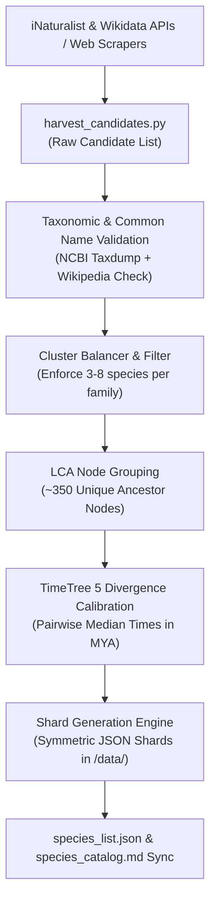

# 🧬 Phylogenle: Systematic Biodiversity Expansion Architecture & Blueprint

**Document Version:** 1.0  
**Target Database Expansion:** 344 ➔ ~600–700 Curated Species  
**Objective:** Replace ad-hoc manual additions with an automated, data-driven pipeline that scrapes authoritative biological databases to eliminate "island species" and establish rich sister-species clusters.

---

## 1. Problem Statement & Design Principles

### Why Ad-Hoc / "LLM Memory" Additions Fail
1. **Isolated "Island" Taxa:** Adding a single organism (e.g., only 1 hummingbird or 1 butterfly) breaks gameplay. When a player deduces the Family (e.g., *Trochilidae*), their logical next move is to guess another hummingbird. If no sister species exist in the dictionary, the game feels incomplete and frustrating.
2. **Recognition Imbalance:** Uncurated taxonomy queries risk adding obscure micro-organisms (e.g., microscopic nematodes or deep-sea mites with no common names) that normal players cannot guess.
3. **Nomenclature Inconsistencies:** Outdated synonyms or disputed common names break autocomplete and Wikipedia linking.

### Core Architectural Principles
- **The "No Island Species" Rule:** Every organism in the game must belong to a cluster of at least **3 to 8 recognizable species** within the same Family or Genus.
- **Cultural & Educational Recognition:** Every candidate must pass a popularity filter (Wikipedia pageviews / iNaturalist observation counts).
- **100% Cladistic & Temporal Integrity:** Every species must have a verified NCBI TaxID and peer-reviewed divergence time from TimeTree 5.

---

## 2. Authoritative Data Sources for Scraping & Ingestion

Instead of manual guessing, we will extract candidates programmatically from 5 authoritative biodiversity platforms:

### A. iNaturalist Research API (`api.inaturalist.org/v1`)
* **Endpoint:** `GET /observations/species_counts?taxon_id=35521&quality_grade=research`
* **Purpose:** Queries the most observed wild animals in the world.
* **Why it matters:** 
  - Guarantees that every species has an official, widely used English common name.
  - Ensures every animal is something real people observe and recognize (e.g., Blue Morpho, Anna's Hummingbird, Red-tailed Hawk).

### B. Wikidata SPARQL Knowledge Graph (`query.wikidata.org`)
* **Query Mechanism:** SPARQL endpoint querying instances of Taxon (`wdt:P31 wd:Q16521`) within Kingdom Animalia (`wdt:P171* wd:Q729`).
* **Filtering Criteria:**
  - Must have an English Wikipedia sitelink (`wikibase:sitelinks > 15`).
  - Must have a verified NCBI TaxID property (`wdt:P685`).
  - Sorted by monthly pageview count to filter out obscure scientific papers.

### C. IUCN Red List Global Database API (`apiv3.iucnredlist.org`)
* **Purpose:** Harvests high-profile, globally iconic species across conservation categories (Critically Endangered, Vulnerable, Least Concern).
* **Why it matters:** Captures charismatic megafauna and famous conservation icons that players frequently search for (e.g., Axolotl, Snow Leopard, Vaquita, Leatherback Sea Turtle, Kakapo).

### D. Wikipedia Zoology Portals & Featured Lists
* **Scraping Targets:**
  - Wikipedia: *List of birds by common name* / *List of hummingbird species*
  - Wikipedia: *List of butterflies of North America and Europe*
  - Wikipedia: *List of canids / List of felids / List of cetaceans*
  - Wikipedia: *List of sharks / List of snakes*
* **Extraction:** Programmatic regex/BeautifulSoup parser pulling `Common Name (Scientific Name)`.

### E. Local NCBI Taxonomy & TimeTree Calibration (Already in Repository)
* **Local NCBI Taxdump (`taxdump.tar.gz`):** Offline tree traversal via `ete3` to verify lineages, ranks (Kingdom, Phylum, Class, Order, Family, Genus), and Lowest Common Ancestor (LCA) nodes.
* **TimeTree 5 (`timetree.org`):** Automated retrieval of median evolutionary divergence times in Millions of Years Ago (MYA).

---

## 3. High-Priority Taxonomic Expansion Clusters

The table below outlines the 10 core biodiversity clusters scheduled for expansion to achieve balanced gameplay:

| Clade / Cluster | Current Count | Target Count | High-Priority Species to Harvest & Ingest |
| :--- | :---: | :---: | :--- |
| **1. Hummingbirds** *(Trochilidae)* | 1 | **5** | • Anna's Hummingbird (*Calypte anna*) • Rufous Hummingbird (*Selasphorus rufus*) • Bee Hummingbird (*Mellisuga helenae*) [World's smallest bird] • Sword-billed Hummingbird (*Ensifera ensifera*) |
| **2. Butterflies & Moths** *(Lepidoptera)* | 4 | **12** | • Blue Morpho (*Morpho peleides*) • Painted Lady (*Vanessa cardui*) • Peacock Butterfly (*Aglais io*) • Zebra Longwing (*Heliconius charithonia*) • Eastern Tiger Swallowtail (*Papilio glaucus*) • Luna Moth (*Actias luna*) • Death's-head Hawkmoth (*Acherontia atropos*) • Peppered Moth (*Biston betularia*) |
| **3. Birds of Prey & Owls** *(Accipitriformes, Falconiformes, Strigiformes)* | 12 | **22** | • Harpy Eagle (*Harpia harpyja*) • Golden Eagle (*Aquila chrysaetos*) • Gyrfalcon (*Falco rusticolus*) • Red-tailed Hawk (*Buteo jamaicensis*) • Cooper's Hawk (*Accipiter cooperii*) • Great Horned Owl (*Bubo virginianus*) • Snowy Owl (*Bubo scandiacus*) • Eurasian Eagle-Owl (*Bubo bubo*) • Burrowing Owl (*Athene cunicularia*) • Secretarybird (*Sagittarius serpentarius*) |
| **4. Whales, Dolphins & Porpoises** *(Cetacea)* | 9 | **18** | • Sperm Whale (*Physeter macrocephalus*) • Narwhal (*Monodon monoceros*) • Spinner Dolphin (*Stenella longirostris*) • Amazon River Dolphin (*Inia geoffrensis*) • Long-finned Pilot Whale (*Globicephala melas*) • False Killer Whale (*Pseudorca crassidens*) • Vaquita (*Phocoena sinus*) • Commerson's Dolphin (*Cephalorhynchus commersonii*) |
| **5. Bears & Canids** *(Ursidae & Canidae)* | 13 | **22** | • Grizzly / Brown Bear (*Ursus arctos*) • Polar Bear (*Ursus maritimus*) • Gray Fox (*Urocyon cinereoargenteus*) • Golden Jackal (*Canis aureus*) • Maned Wolf (*Chrysocyon brachyurus*) • Raccoon Dog / Tanuki (*Nyctereutes procyonoides*) • Bush Dog (*Speothos venaticus*) |
| **6. Wild Felines** *(Felidae)* | 13 | **20** | • Snow Leopard (*Panthera uncia*) • Bobcat (*Lynx rufus*) • Canada Lynx (*Lynx canadensis*) • Eurasian Lynx (*Lynx lynx*) • Pallas's Cat (*Otocolobus manul*) • Sand Cat (*Felis margarita*) • Black-footed Cat (*Felis nigripes*) |
| **7. Snakes** *(Serpentes)* | 9 | **18** | • Black Mamba (*Dendroaspis polylepis*) • Inland Taipan (*Oxyuranus microlepidotus*) • Timber Rattlesnake (*Crotalus horridus*) • Cottonmouth / Water Moccasin (*Agkistrodon piscivorus*) • Copperhead (*Agkistrodon contortrix*) • Boa Constrictor (*Boa constrictor*) • Ball Python (*Python regius*) • Eastern Milk Snake (*Lampropeltis triangulum*) • Green Tree Python (*Morelia viridis*) |
| **8. Sharks & Rays** *(Chondrichthyes)* | 7 | **16** | • Tiger Shark (*Galeocerdo cuvier*) • Bull Shark (*Carcharhinus leucas*) • Shortfin Mako Shark (*Isurus oxyrinchus*) • Thresher Shark (*Alopias vulpinus*) • Basking Shark (*Cetorhinus maximus*) • Greenland Shark (*Somniosus microcephalus*) • Leopard Shark (*Triakis semifasciata*) • Spotted Eagle Ray (*Aetobatus narinari*) • Southern Stingray (*Hypanus americanus*) |
| **9. Cephalopods & Marine Mollusks** *(Cephalopoda)* | 8 | **15** | • Mimic Octopus (*Thaumoctopus mimicus*) • Dumbo Octopus (*Grimpoteuthis*) • Humboldt Squid (*Dosidicus gigas*) • Bigfin Reef Squid (*Sepioteuthis lessoniana*) • Flamboyant Cuttlefish (*Metasepia pfefferi*) • Striped Pyjama Squid (*Sepioloidea lineolata*) |
| **10. Primates** *(Primates)* | 20 | **28** | • Hamadryas Baboon (*Papio hamadryas*) • Olive Baboon (*Papio anubis*) • White-faced Capuchin (*Cebus capucinus*) • Cotton-top Tamarin (*Saguinus oedipus*) • Ring-tailed Lemur (*Lemur catta*) • Coquerel's Sifaka (*Propithecus coquereli*) • Mouse Lemur (*Microcebus murinus*) |

---

## 4. Technical Ingestion Pipeline Architecture

### Step-by-Step Implementation Workflow:

1. **Candidate Harvester (`scripts/harvest_candidates.py`):**
   - Automatically hits iNaturalist and Wikipedia list pages.
   - Extracts formatted pairs: `Common Name (Genus species)`.
   - Filters by minimum Wikipedia article length and observation thresholds.

2. **Taxonomic Validator (`scripts/validate_candidates.py`):**
   - Resolves every scientific name against `NCBITaxa()`.
   - Verifies the organism is an accepted species (rejects subspecies or fossil-only extinct taxa unless explicitly curated).
   - Validates that a clean Wikipedia article exists with a valid thumbnail for tooltip preview.

3. **Cluster Balancer (`scripts/balance_clusters.py`):**
   - Checks the distribution across Orders and Families.
   - Flags any single-species "islands" and pulls sibling species from the same genus/family to reach minimum cluster depth.

4. **Tree Node Calibrator & Shard Generator (`scripts/build_shards.py`):**
   - Groups all species pairs by their Lowest Common Ancestor (LCA) node.
   - For any uncalibrated node, queries TimeTree API with reciprocal caching.
   - Generates all `.json` shard files with symmetrical divergence times:
     $$\text{Divergence}(A, B) \equiv \text{Divergence}(B, A)$$
   - Updates `data/species_list.json`, `data/time_cache.json`, and `species_catalog.md`.

---

## 5. Review & Sign-Off Checklist

Before running the batch ingestion pipeline, review and approve:
- [ ] **Cluster Targets:** Are the 10 selected groups balanced to your satisfaction?
- [ ] **Exclusions:** Are there specific groups you want excluded (e.g. plants, fungi, bacteria remain excluded to keep game strictly animal-focused)?
- [ ] **Target Pool Size:** Is 550–650 species the desired final database size?
- [ ] **Square Emoji Scheme:** Selection of preferred emoji square mapping for the share grid.

---
*Generated for Phylogenle development — Path: `/Users/amitjoshi2724/Desktop/phylogenle/SPECIES_EXPANSION_PLAN.md`*
