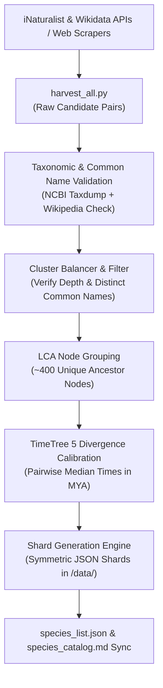

# 🧬 Phylogenle: Systematic Biodiversity Expansion Architecture & Blueprint

**Document Version:** 2.0 (Unbounded Maximum Harvesting Edition)  
**Target Pool:** 344 ➔ **1,000+ Fully Calibrated Species**  
**Purpose:** Technical specification for the automated web-scraping and API ingestion pipeline to expand the Phylogenle dictionary to 1,000+ organisms without artificial ceilings.

---

## 1. Architectural Directives

- **NO UPPER BOUND ON CLUSTER SIZE:**  
  Previous drafts imposed an artificial cap of 8 species per cluster. This limit has been completely removed. If a family or genus contains 15, 25, 40, or more recognizable species (e.g., all hummingbirds, all butterflies, all sharks, all owls, all canids, all whales, all wild felines), **we scrape and ingest every single one of them**.
- **Minimum Cluster Depth ($\ge 3$):**  
  Every organism in the game must belong to a cluster of at least 3 recognizable species within the same Family or Genus. This guarantees that whenever a player deduces a family, they always have sister species available to test.
- **Cultural & Educational Recognition Filter:**  
  Every candidate must be a recognizable wild or domesticated animal with an established common name, supported by iNaturalist research-grade observation frequency and English Wikipedia pageviews. No obscure micro-nematodes or microscopic mites.
- **100% Cladistic & Temporal Integrity:**  
  Every single species is cross-referenced with local NCBI Taxonomy (`NCBITaxa()`) and peer-reviewed TimeTree 5 divergence times.

---

## 2. Authoritative Data Sources for Scraping & Ingestion

Rather than relying on LLM memory or ad-hoc lists, candidates will be extracted programmatically from 5 authoritative biodiversity platforms:

### A. iNaturalist Research-Grade API (`api.inaturalist.org/v1`)
* **Endpoint:** `GET /observations/species_counts?quality_grade=research`
* **Filtering:** Queries top-observed wild species worldwide across Aves, Mammalia, Reptilia, Amphibia, Actinopterygii, Chondrichthyes, Insecta, Arachnida, Malacostraca, and Cephalopoda.
* **Why it matters:** Guarantees that every species has an official, widely used English common name and represents an animal that real people observe and recognize in the wild.

### B. Wikidata SPARQL Knowledge Graph (`query.wikidata.org`)
* **Query Mechanism:** SPARQL endpoint querying instances of Taxon (`wdt:P31 wd:Q16521`) within Kingdom Animalia (`wdt:P171* wd:Q729`).
* **Filtering Criteria:**
  - Must have an English Wikipedia sitelink (`wikibase:sitelinks > 15`).
  - Must have a verified NCBI TaxID property (`wdt:P685`).
  - Sorted by monthly pageview count to filter out obscure scientific papers.

### C. IUCN Red List Global Database API (`apiv3.iucnredlist.org`)
* **Purpose:** Harvests high-profile, globally iconic species across conservation categories (Critically Endangered, Endangered, Vulnerable, and Least Concern).
* **Why it matters:** Captures famous global conservation icons (e.g., Axolotl, Pangolin, Vaquita, Kakapo, Mountain Gorilla, Gharial).

### D. Wikipedia Zoology Portals & Complete Family Tables
* **Scraping Targets:**
  - Wikipedia: *List of birds by common name* / *List of hummingbird species*
  - Wikipedia: *List of butterflies of North America and Europe*
  - Wikipedia: *List of canids / List of felids / List of cetaceans*
  - Wikipedia: *List of sharks / List of snakes*
* **Extraction:** Programmatic BeautifulSoup parser pulling `Common Name (Scientific Name)`.

### E. Local NCBI Taxonomy & TimeTree Calibration (Already in Repository)
* **Local NCBI Taxdump (`taxdump.tar.gz`):** Offline tree traversal via `ete3` to verify lineages, ranks (Kingdom, Phylum, Class, Order, Family, Genus), and Lowest Common Ancestor (LCA) nodes.
* **TimeTree 5 (`timetree.org`):** Automated node-level retrieval of median evolutionary divergence times in Millions of Years Ago (MYA).

---

## 3. Comprehensive Target Scope Across Clades (1,000+ Pool)

| Clade | Current Pool | Target Pool | Comprehensive Harvesting Scope |
| :--- | :---: | :---: | :--- |
| **Mammalia** | 148 | **~350+** | All Primates (apes, baboons, lemurs, tamarins, marmosets), all Carnivora (cats, dogs, bears, seals, otters, weasels, hyenas, civets), all Cetaceans (baleen whales, toothed whales, dolphins, porpoises), all Ungulates (deer, antelopes, cattle, horses, rhinos, tapirs), all Marsupials (kangaroos, wallabies, possums, bandicoots, quolls). |
| **Aves (Birds)** | 57 | **~250+** | All Hummingbirds, all Birds of Prey (eagles, hawks, harriers, kites), all Owls (horned, barn, screech, snowy), all Waterfowl (ducks, geese, swans), all Parrots (macaws, cockatoos, lories, parakeets), all Seabirds (albatrosses, petrels, puffins, penguins), all Ratites (ostrich, emu, rhea, kiwi, cassowary), Corvid songbirds. |
| **Reptiles** | 32 | **~120+** | All venomous snakes (cobras, mambas, vipers, rattlesnakes, taipans, kraits), all constrictors (anacondas, boas, pythons), all crocodilians (crocodiles, alligators, caimans, gharials), all sea turtles and tortoises, monitor lizards, chameleons, geckos, iguanas. |
| **Fishes** | 33 | **~130+** | All major Sharks (Great White, Tiger, Bull, Hammerheads, Mako, Thresher, Basking, Whale, Greenland, Nurse, Leopard), all major Rays and Skates, pelagic game fish (tunas, billfish, marlins, swordfish), reef fish (angelfish, clownfish, tangs, butterflyfish), deep sea oddities (anglerfish, gulper eel, coelacanth). |
| **Invertebrates** | 58 | **~150+** | Cephalopods (all octopuses, squids, cuttlefish, nautilus), Crustaceans (crabs, lobsters, shrimp, mantis shrimp), Insects (butterflies, moths, beetles, ants, bees, wasps, dragonflies, praying mantises), Arachnids (tarantulas, true spiders, scorpions), Cnidarians (jellyfish, anemones, corals), Echinoderms. |
| **Amphibians** | 16 | **~50+** | Poison dart frogs, tree frogs, true toads, bullfrogs, glass frogs, axolotls, newts, giant salamanders, fire salamanders, hellbenders, caecilians. |
| **TOTAL POOL** | **344** | **1,000+** | **Comprehensive, fully interconnected phylogenetic web.** |

---

## 4. Technical Ingestion Pipeline Architecture

### Script Workflow:

1. **`harvest_all.py`:**  
   Asynchronous scraper collecting candidates from iNaturalist, Wikidata SPARQL, and Wikipedia tables. Output: `raw_candidates.json`.
2. **`filter_validate.py`:**  
   Offline verification via `ete3.NCBITaxa()`. Resolves exact scientific names, ensures valid TaxID, verifies clean English common name, and confirms active Wikipedia slug.
3. **`generate_all_shards.py`:**  
   Groups pairs by Lowest Common Ancestor (LCA) node. Queries TimeTree once per unique LCA node with caching. Generates all symmetric pairwise JSON shards in `/data/`.
4. **`update_catalog.py`:**  
   Updates `data/species_list.json`, `data/time_cache.json`, and generates the human-readable markdown breakdown in `species_catalog.md`.

---
*For game manual, rules, and color square guide, see [`README.md`](README.md).*
