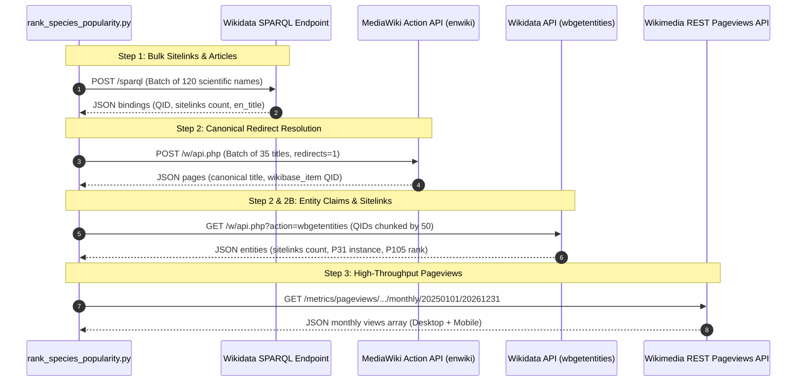
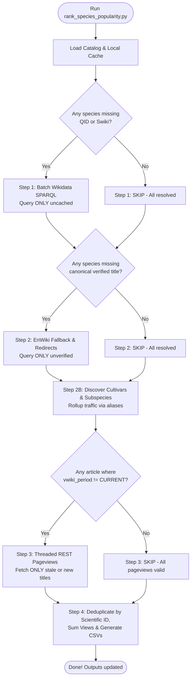

# 🧬 Architecture & Operations: `rank_species_popularity.py`

> **Document Version:** 2.0 (Comprehensive API & Empirical Metric Deep Dive)  
> **Target Audience:** Core Contributors, Maintainers, & Researchers  
> **Script Path:** [`rank_species_popularity.py`](file:///Users/amitjoshi2724/Desktop/phylogenle/rank_species_popularity.py)  
> **Last Updated:** 2026-10-30  

---

## 1. Executive Summary & Purpose

In **Phylogenle**, players deduce an unknown daily mystery organism by exploring evolutionary divergence points on a phylogenetic tree. To ensure the game is fun and accessible, organisms are sorted into difficulty tiers:
- 🐾 **Easy Tier** (Top 1,000 most recognizable organisms)
- 🌿 **Normal Tier** (Ranks 1,001 – 2,000)
- 🔬 **Advanced Tier** (Ranks 2,001 – 5,000)
- ⚡ **Master Tier** (Ranks 5,001 – 26,000+)

Without empirical popularity data, an obscure deep-sea polychaete worm or soil bacterium would have the exact same likelihood of appearing in Easy Tier as a Tiger, Blue Whale, or Giant Sequoia.

`rank_species_popularity.py` is the **Phase 1A Empirical Harvester & Ranker**. It harvests two independent empirical signals for every organism in the master catalog ([`data/species_taxonomy_catalog.json`](file:///Users/amitjoshi2724/Desktop/phylogenle/data/species_taxonomy_catalog.json)):

1. **$S_{\text{wiki}}$ (Wikidata Sitelinks):** The total number of different language Wikipedia editions that have dedicated an article to this organism (a measure of global, cross-cultural recognition).
2. **$V_{\text{wiki}}$ (English Wikipedia Pageviews):** The cumulative human traffic (monthly granularity over a multi-year window, currently **2025–2026**) across English Wikipedia.

It then deduplicates entries by primary biological species ID (scientific name), rolls up domestic forms and subspecies, and exports three comprehensive ranking documents to [`docs/`](file:///Users/amitjoshi2724/Desktop/phylogenle/docs/).

---

## 2. Deep Dive: The Two Empirical Popularity Metrics ($S_{\text{wiki}}$ vs. $V_{\text{wiki}}$)

The ranking engine relies on two distinct empirical metrics harvested from the Wikimedia Foundation's open knowledge graph. Each metric measures a fundamentally different dimension of organism prominence.

```
+-------------------------------------------------------------------------------------------------------+
|                                    WIKIMEDIA DATA SIGNALS COMPARISON                                  |
+-------------------------------------------------------------------------------------------------------+
|  Metric     | Source                     | What It Measures                    | Primary Advantage   |
|-------------+----------------------------+-------------------------------------+---------------------|
|  S_wiki     | Wikidata Knowledge Graph   | Cross-cultural, global consensus    | Immune to viral     |
|             | (?item wikibase:sitelinks) | across 300+ language editions       | news/media spikes   |
|-------------+----------------------------+-------------------------------------+---------------------|
|  V_wiki     | Wikimedia REST API         | Real human curiosity & readership   | Matches player      |
|             | (/metrics/pageviews/...)   | in English over 24-month window     | intuition & culture |
+-------------------------------------------------------------------------------------------------------+
```

### 2.1 Metric 1: $S_{\text{wiki}}$ (Wikidata Global Sitelinks)

#### What Is a Sitelink?
In Wikidata, every entity has a unique identifier (e.g., `Q140` for *Lion*, `Q144` for *Dog*). A **sitelink** is an explicit pointer linking that central Wikidata concept to an article about that concept in a specific Wikipedia language edition (such as English `en.wikipedia.org`, Spanish `es.wikipedia.org`, Japanese `ja.wikipedia.org`, Arabic `ar.wikipedia.org`, Swahili `sw.wikipedia.org`, etc.).

#### Why $S_{\text{wiki}}$ Matters
- **Global Cross-Cultural Consensus:** If an organism has an article in 180+ languages, it is recognized universally across civilization—not just in the English-speaking world.
- **Immunity to Short-Term Fads:** A viral meme on TikTok or a temporary news event might generate millions of English views for a few days, but it will **not** cause 150 separate international volunteer Wikipedia communities to translate and publish standalone encyclopedic entries.
- **Benchmark Champions:** Organisms with the highest $S_{\text{wiki}}$ globally:
  - *Homo sapiens* (Human): ~300 languages
  - *Panthera leo* (Lion): ~205 languages
  - *Canis lupus* (Wolf/Dog): ~195 languages
  - *Malus domestica* (Apple): ~190 languages
  - *Apis mellifera* (Western Honey Bee): ~185 languages

#### Limitations of $S_{\text{wiki}}$
- **Bot-Generated Taxonomic Stubs:** In some smaller language Wikipedias (e.g., Cebuano, Waray, Swedish), automated bots historically created millions of 1-sentence stubs for obscure beetles and snails based on GBIF or Catalogue of Life databases. This can artificially inflate the sitelink count of an obscure snail from 1 to 15.
- **Lagging Indicator:** Sitelink counts grow slowly over decades as encyclopedia contributors write translations.

---

### 2.2 Metric 2: $V_{\text{wiki}}$ (English Wikipedia Cumulative Pageviews)

#### What Is $V_{\text{wiki}}$?
$V_{\text{wiki}}$ represents the **exact count of human visits** to the organism's English Wikipedia article across all devices (desktop, mobile web, and official mobile apps), aggregated monthly over a multi-year period (default: `20250101` to `20261231`).

#### Why $V_{\text{wiki}}$ Matters
- **Real-Time Cultural Salience:** Players interact with the game in English. $V_{\text{wiki}}$ captures what English speakers actively think about, research, watch documentaries on, and learn about in school.
- **Resolving High-Interest Organisms:** Many organisms that have moderate sitelinks (~40–60 languages) have massive cultural popularity in English-speaking regions:
  - *Blue-ringed Octopus* (*Hapalochlaena*): ~1.27M views
  - *Axolotl* (*Ambystoma mexicanum*): ~3.8M views
  - *Capybara* (*Hydrochoerus hydrochaeris*): ~4.2M views
  - *Peregrine Falcon* (*Falco peregrinus*): ~2.1M views
  - *Venus Flytrap* (*Dionaea muscipula*): ~1.9M views
- **Automated Bot Filtering:** The Wikimedia Foundation's Pageview API runs proprietary bot/crawler detection algorithms. When querying `agent: all-agents`, the metric captures legitimate human pageviews while filtering out standard web scrapers and search engine indexers.

#### Limitations of $V_{\text{wiki}}$
- **Name Collisions & Ambiguity:** A common English word might refer to multiple concepts (e.g., *"Kiwi"* refers to the bird, the fruit, and people from New Zealand). This is why the pipeline uses MediaWiki canonical page properties (`wikibase_item`) to map specifically to the biological taxon entity.
- **Temporary Media Spikes:** A Hollywood movie (e.g., *Cocaine Bear*) or a viral meme can temporarily boost an article's traffic. Aggregating across a full 24-month window smoothes out short-term anomalies.

---

## 3. Comprehensive Breakdown of the 4 API Calls

[`rank_species_popularity.py`](file:///Users/amitjoshi2724/Desktop/phylogenle/rank_species_popularity.py) interfaces with **four distinct endpoints** across the Wikimedia ecosystem. Here are the exact request structures, headers, payloads, and response formats.



---

### 3.1 API Call #1: Wikidata SPARQL Query Service (Batch Sitelinks)

#### Endpoint & HTTP Specifications
- **URL:** `https://query.wikidata.org/sparql`
- **Method:** `POST`
- **Headers:**
  ```http
  User-Agent: Phylogenle/1.0 (educational evolutionary biology puzzle game; https://amitjoshi2724.github.io/phylogenle/; [EMAIL_ADDRESS])
  Content-Type: application/x-www-form-urlencoded
  Accept: application/sparql-results+json
  ```
- **Batch Size:** 120 scientific names per HTTP POST.

#### SPARQL Query Syntax
```sparql
SELECT ?scientificName ?item ?sitelinks ?enTitle WHERE {
  VALUES ?scientificName { "Panthera leo" "Homo sapiens" "Tyto alba" "Electrophorus electricus" ... }
  ?item wdt:P225 ?scientificName .
  ?item wikibase:sitelinks ?sitelinks .
  OPTIONAL {
    ?article schema:about ?item ;
             schema:isPartOf <https://en.wikipedia.org/> ;
             schema:name ?enTitle .
  }
}
```

#### Detailed Field Explanation
1. `VALUES ?scientificName { ... }`: Injects the 120 binomial names into a single query block, replacing 120 individual round-trip requests with 1.
2. `?item wdt:P225 ?scientificName`: `P225` is Wikidata’s official **Taxon Name** property. It anchors the query directly to the biological taxon record.
3. `?item wikibase:sitelinks ?sitelinks`: `wikibase:sitelinks` is a precomputed integer stored in Wikidata’s triplestore representing the total number of connected Wikipedia language articles.
4. `OPTIONAL { ... schema:isPartOf <https://en.wikipedia.org/> ... }`: Finds the exact title of the English Wikipedia article if one exists, without discarding species that lack an English article.

#### Raw JSON Response Format
```json
{
  "head": {
    "vars": [ "scientificName", "item", "sitelinks", "enTitle" ]
  },
  "results": {
    "bindings": [
      {
        "scientificName": { "type": "literal", "value": "Panthera leo" },
        "item": { "type": "uri", "value": "http://www.wikidata.org/entity/Q140" },
        "sitelinks": { "datatype": "http://www.w3.org/2001/XMLSchema#integer", "type": "literal", "value": "205" },
        "enTitle": { "type": "literal", "value": "Lion" }
      },
      {
        "scientificName": { "type": "literal", "value": "Tyto alba" },
        "item": { "type": "uri", "value": "http://www.wikidata.org/entity/Q25317" },
        "sitelinks": { "datatype": "http://www.w3.org/2001/XMLSchema#integer", "type": "literal", "value": "112" },
        "enTitle": { "type": "literal", "value": "Western barn owl" }
      }
    ]
  }
}
```

---

### 3.2 API Call #2: MediaWiki Action API (Redirect & Canonical Resolution)

#### Why This Call Is Essential
Wikidata often contains only the scientific binomial, but the English Wikipedia article might be located under a common name (e.g. *Canis lupus* $\rightarrow$ *Wolf*), or under a title that has since been moved or redirected. Furthermore, Latin spelling variations, hyphens, and gender declensions (*-us* vs *-a*) must be normalized.

#### Endpoint & HTTP Specifications
- **URL:** `https://en.wikipedia.org/w/api.php`
- **Method:** `POST`
- **Headers:**
  ```http
  User-Agent: Phylogenle/1.0 (educational evolutionary biology puzzle game; https://amitjoshi2724.github.io/phylogenle/; [EMAIL_ADDRESS])
  Content-Type: application/x-www-form-urlencoded
  ```
- **Payload Parameters:**
  ```python
  {
      "action": "query",
      "titles": "|".join(chunk),      # Up to 35 titles separated by pipes
      "prop": "pageprops",            # Requests page metadata
      "redirects": "1",               # Automatically resolves redirects!
      "format": "json"
  }
  ```

#### Raw JSON Response Format
When querying titles like `"sand dollar"`, `"Canis lupus familiaris"`, and `"Uca pugilator"`:
```json
{
  "query": {
    "normalized": [
      { "from": "sand dollar", "to": "Sand dollar" }
    ],
    "redirects": [
      { "from": "Canis lupus familiaris", "to": "Dog" },
      { "from": "Uca pugilator", "to": "Atlantic sand fiddler crab" }
    ],
    "pages": {
      "4269": {
        "pageid": 4269,
        "ns": 0,
        "title": "Dog",
        "pageprops": {
          "wikibase_item": "Q144"
        }
      },
      "129841": {
        "pageid": 129841,
        "ns": 0,
        "title": "Sand dollar",
        "pageprops": {
          "wikibase_item": "Q638541"
        }
      }
    }
  }
}
```

#### How the Script Resolves Multi-Hop Redirect Chains
MediaWiki provides two lookup tables in the response: `normalized` (spelling/case changes) and `redirects` (page pointer changes). 

The helper function [`query_enwiki_fallback_batch()`](file:///Users/amitjoshi2724/Desktop/phylogenle/rank_species_popularity.py#L114-L183) builds an in-memory graph (`alias_to_target` and `canonical_map`) and traverses up to 5 redirect hops for every candidate title until it lands on the terminal page and extracts both:
1. `canonical_title`: The true destination title on English Wikipedia.
2. `wikibase_item`: The Wikidata QID directly bound to that Wikipedia article.

---

### 3.3 API Call #3: Wikidata Entity API (`wbgetentities`)

#### Endpoint & HTTP Specifications
- **URL:** `https://www.wikidata.org/w/api.php`
- **Method:** `GET`
- **Headers:** `User-Agent: Phylogenle/1.0 ...`
- **Usage 1 (Sitelink Enrichment):**
  `?action=wbgetentities&ids=Q144|Q638541&props=sitelinks&format=json`
  - Fetches the total sitelink count for newly discovered canonical QIDs.
- **Usage 2 (Taxon Rank & Biological Verification in Step 2B):**
  `?action=wbgetentities&ids=Q144|Q12345&props=claims&format=json`
  - Inspects `claims.P31` (**instance of**) and `claims.P105` (**taxon rank**).

#### Step 2B Verification Logic
To prevent an article about a broad family or random concept from being stolen by a single species, the script validates:
- **Valid Instance Types (`P31`):** Must match taxon (`Q16521`), subspecies (`Q23038290`), breed (`Q38829`), cultivar (`Q4886`), or organism group.
- **Forbidden Higher Taxon Ranks (`P105`):** Must **NOT** be a Genus (`Q35409`), Family (`Q36732`), Order (`Q38348`), Class (`Q16428`), or Phylum (`Q34740`).

---

### 3.4 API Call #4: Wikimedia REST API Pageviews Metric Endpoint

#### Endpoint & HTTP Specifications
- **URL Template:**
  ```text
  https://wikimedia.org/api/rest_v1/metrics/pageviews/per-article/en.wikipedia.org/all-access/all-agents/{clean_title}/monthly/{start_date}/{end_date}
  ```
- **Method:** `GET`
- **Path Parameters:**
  - `project`: `en.wikipedia.org` (English Wikipedia)
  - `access`: `all-access` (aggregates Desktop, Mobile Web, and Mobile App)
  - `agent`: `all-agents` (filters out automated search engine crawlers and spiders)
  - `clean_title`: URL-encoded article title with spaces replaced by underscores (e.g. `Panthera_leo`, `Blue_whale`, `Western_barn_owl`)
  - `granularity`: `monthly`
  - `start_date`: `20250101`
  - `end_date`: `20261231`

#### Raw JSON Response Format
```json
{
  "items": [
    {
      "project": "en.wikipedia",
      "article": "Lion",
      "granularity": "monthly",
      "timestamp": "2025010100",
      "access": "all-access",
      "agent": "all-agents",
      "views": 412589
    },
    {
      "project": "en.wikipedia",
      "article": "Lion",
      "granularity": "monthly",
      "timestamp": "2025020100",
      "access": "all-access",
      "agent": "all-agents",
      "views": 389210
    },
    {
      "project": "en.wikipedia",
      "article": "Lion",
      "granularity": "monthly",
      "timestamp": "2025030100",
      "access": "all-access",
      "agent": "all-agents",
      "views": 421004
    }
  ]
}
```

#### Cumulative Summation
The script loops through every entry in `data["items"]` and computes:
$$V_{\text{cumulative}} = \sum_{m \in \text{items}} m[\text{"views"}]$$
For *Lion*, summing all monthly items across 2025–2026 yields **~8,842,000 views**.

#### HTTP Status Handling
- `200 OK`: Returns parsed integer total.
- `404 Not Found`: Article does not exist or has 0 pageviews in this period $\rightarrow$ returns `0`.
- `429 Too Many Requests`: Triggers exponential backoff (`time.sleep(2 ** attempt)`).
- `502 / 503 Bad Gateway / Service Unavailable`: Wikimedia server load $\rightarrow$ triggers exponential backoff.
- Transient Failure after 6 attempts: Returns `None` so the cache entry is **not corrupted**.

---

## 4. The "Only Do What Needs to Be Done" Philosophy

Running API queries across **26,320+ species** against Wikimedia’s public infrastructure from scratch would take **hours** and quickly trigger rate-limits (HTTP 429) if not carefully engineered.

The script operates on an **Incremental Delta Engine** backed by a persistent cache ([`data/wikimedia_popularity_cache.json`](file:///Users/amitjoshi2724/Desktop/phylogenle/data/wikimedia_popularity_cache.json)). When you run the script, it evaluates every step against the existing cache and skips any work that has already been verified.



### 4.1 The Cache Data Schema
Every organism entry in [`data/wikimedia_popularity_cache.json`](file:///Users/amitjoshi2724/Desktop/phylogenle/data/wikimedia_popularity_cache.json) contains:
```json
"Panthera tigris": {
  "common": "Tiger",
  "scientific": "Panthera tigris",
  "kingdom": "Animalia",
  "class": "Mammalia",
  "order": "Carnivora",
  "family": "Felidae",
  "qid": "Q19939",
  "swiki": 196,
  "en_title": "Tiger",
  "canonical_verified": true,
  "vwiki": 6542100,
  "vwiki_period": "vwiki_20250101_20261231",
  "extra_articles": {
    "Bengal tiger": 1243100,
    "Siberian tiger": 951000
  }
}
```

### 4.2 Delta Filtering Criteria per Step
| Step | What Triggers Work? | Filter Logic in Code |
| :--- | :--- | :--- |
| **Step 1 (Wikidata SPARQL)** | Species not in cache, or `qid is None`, or missing `swiki`. | `s["scientific"] not in cache or cache[s["scientific"]].get("qid") is None or "swiki" not in cache[s["scientific"]]` |
| **Step 2 (Wikipedia Canonical)** | Species has no `en_title` or has not been `canonical_verified`. | `not cache.get(s["scientific"], {}).get("en_title") or not cache.get(s["scientific"], {}).get("canonical_verified")` |
| **Step 3 (Wikimedia Pageviews)** | Article has `vwiki_period != CACHE_PERIOD_KEY` or `vwiki == 0` on an un-queried title. | `rec.get("vwiki_period") != CACHE_PERIOD_KEY` |

### 4.3 Automatic Invalidation Hooks
If Step 2 detects that an organism's article was renamed or redirected to a better canonical title (for example, from a scientific synonym to an English common name):
```python
if best_title != cache[sci].get("en_title"):
    cache[sci]["en_title"] = best_title
    cache[sci]["vwiki_period"] = None  # Immediately invalidates cached views!
```
By setting `vwiki_period = None`, Step 3 will automatically harvest pageviews for the new article title during the very next run.

### 4.4 Cache Poisoning Defense
If a network disconnect, socket timeout, or 503 service error occurs during traffic fetching:
- The script retries up to **6 times** with exponential backoff (`2^attempt` seconds).
- If all 6 attempts fail, the helper returns `(title, None)`.
- The harvester checks `if views is not None:`. If it is `None`, **it does NOT write `views = 0` to the cache** and does NOT set `vwiki_period`. This prevents transient network glitches from permanently poisoning high-popularity animals with zero views.

### 4.5 Periodic Checkpointing
Every 200 fetched articles and at the completion of every batch, `save_cache(cache)` writes directly to disk. If the script is interrupted (Ctrl+C, power loss), zero progress is lost—restarting picks up exactly where it left off.

---

## 5. End-to-End Pipeline Walkthrough

### Step 1: High-Speed Wikidata SPARQL Harvesting
- **Objective:** Map each scientific name to its Wikidata entity (`qid`), count cross-wiki sitelinks (`swiki`), and find the English Wikipedia article (`en_title`).
- **Optimization:** Instead of querying 26,000 species one by one, species are chunked into **batches of 120 names** and sent via HTTP `POST` to the Wikidata SPARQL endpoint (`https://query.wikidata.org/sparql`).
- **Sitelink Tie-Breaking:** If multiple Wikidata entities exist for the same scientific name (e.g., historical duplicates or synonym entries), the script keeps the entity with the highest sitelink count.

---

### Step 2: English Wikipedia Fallback & Redirect Resolution
- **Objective:** Resolve organisms where Wikidata has no direct English article linked, or where the scientific name redirects to a common English article (e.g., *Canis lupus* $\rightarrow$ *Wolf*).
- **Batching & Chunking:** Sends up to 35 candidates per batch to the MediaWiki API (`en.wikipedia.org/w/api.php?action=query&prop=pageprops&redirects=1`) to strictly honor Wikimedia's 50-title request limit.
- **Linguistic Variations Tested:**
  1. Primary English common name (e.g., `"Sand dollar"`)
  2. Sentence-cased variants (e.g., `"Sand Dollar"` vs `"Sand dollar"`)
  3. Hyphenated vs unhyphenated variations
  4. Scientific name and Latin declension variants (e.g., endings in `-us`, `-a`, `-ii`, `-i`)
- **Canonical Multi-Hop Following:** MediaWiki returns `normalized` and `redirects` arrays. The code walks the redirect chain up to 5 hops to discover the true final canonical article title and its `wikibase_item` QID.
- **Wikidata Sitelink Enrichment:** For any newly resolved QIDs, it calls `wbgetentities` to update their sitelink count.

---

### Step 2B: Option B — Cultivar, Subspecies & Domestic Form Rollup
- **The Biological Dilemma:** In everyday language, people read about *"Domestic dog"* (subspecies *Canis lupus familiaris*), *"Broccoli"* (cultivar of *Brassica oleracea*), or *"Bengal tiger"* (subspecies *Panthera tigris tigris*). If we strictly counted the species-level article alone, these world-famous organisms would appear artificially deflated in popularity.
- **The Solution:** Discover standalone articles for subspecies and domestic forms and add their traffic into the species' total score (`extra_articles`).
- **Strict Guardrails to Prevent Parasitic Traffic Hijacking:**
  1. **Umbrella Word Filtering:** Over 70 broad category names (e.g., *bird*, *fish*, *shark*, *frog*, *owl*, *beetle*, *flower*) are blacklisted.
  2. **Polytypic Genus/Family Filtering:** Any genus or family with more than 1 species in the catalog is barred from being claimed by any single species.
  3. **Wikidata Rank Verification:** The candidate article must have Wikidata claims:
     - Must be an instance of (`P31`) a biological taxon, domestic breed, or cultivar (`Q16521`, `Q23038290`, `Q767728`, `Q4886`, etc.).
     - Must **NOT** have a taxon rank (`P105`) of genus, family, order, or class (`Q35409`, `Q36732`, `Q38348`, etc.).
- **Result:** High-traffic subspecies are credited to their parent species without corrupting higher-order taxonomy.

---

### Step 3: High-Throughput Asynchronous Pageview Harvesting
- **Endpoint:** `https://wikimedia.org/api/rest_v1/metrics/pageviews/per-article/en.wikipedia.org/all-access/all-agents/{title}/monthly/{start_date}/{end_date}`
- **Title Inversion & Deduplication:** Multiple species or aliases might reference the same Wikipedia article. The script groups species by unique Wikipedia title so each Wikipedia URL is queried **exactly once**.
- **Concurrency & Rate-Limiting:**
  - Uses `ThreadPoolExecutor(max_workers=10)` (conservative pool to respect Wikimedia's REST API limits).
  - Exponential backoff on HTTP 429 (Too Many Requests), 502, and 503.
- **Live Terminal Telemetry:** Displays a real-time progress bar with request rate (req/s) and calculated dynamic ETA:
  ```text
  Fetching Views (2025–2026): [██████████████████░░░░░░░░░░░░] 14,200/22,810 ( 62.3%) | 9.8 req/s | ETA: 14m 38s
  ```

---

### Step 4: Biological Deduplication & Ranking Compilation
- **Deduplication by Scientific Name:** The taxonomic catalog contains alternate common names that point to the exact same biological species. The script aggregates all catalog entries by `scientific`:
  - Chooses the cleanest/shortest common name as the primary display label.
  - Collates all alternate names from both the catalog and [`data/species_aliases.json`](file:///Users/amitjoshi2724/Desktop/phylogenle/data/species_aliases.json) into a clean, semicolon-separated `aliases` string.
- **Metric Aggregation:**
  $$\text{Total } V_{\text{wiki}} = V_{\text{base}} + \sum V_{\text{extra\_articles}}$$
- **Filtering Quality Bar:**
  - Requires $S_{\text{wiki}} > 1$ (present in at least 2 global languages).
  - Requires $V_{\text{wiki}} > 1$ (verified human readership).
  - Non-blank Wikipedia article title.
- **Generates Three Independent CSV Review Documents:**
  1. [`docs/species_ranking_by_swiki.csv`](file:///Users/amitjoshi2724/Desktop/phylogenle/docs/species_ranking_by_swiki.csv): Ranked #1 to #N purely by global language sitelinks.
  2. [`docs/species_ranking_by_vwiki.csv`](file:///Users/amitjoshi2724/Desktop/phylogenle/docs/species_ranking_by_vwiki.csv): Ranked #1 to #N purely by English Wikipedia pageviews.
  3. [`docs/species_popularity_rankings.csv`](file:///Users/amitjoshi2724/Desktop/phylogenle/docs/species_popularity_rankings.csv): Combined master dataset featuring both ranks side-by-side for calibration.

---

## 6. How the Final Rankings and Tiers Are Computed

In Step 4, after aggregating all biological data, the script sorts the dataset using a deterministic tuple key:

### 6.1 Ranking by $V_{\text{wiki}}$ (English Wikipedia Pageviews)
```python
by_vwiki = sorted(
    [item for item in all_ranked if item.get("vwiki", 0) > 1 and item.get("swiki", 0) > 1 and bool((item.get("en_title") or "").strip())],
    key=lambda x: (x["vwiki"], x["swiki"], x["common"]),
    reverse=True
)
```
- **Primary Sort Key:** $V_{\text{wiki}}$ (descending). The organism with the most total pageviews across 2025–2026 takes Rank #1.
- **Secondary Sort Key (Tie-breaker 1):** $S_{\text{wiki}}$ (descending). If two organisms have identical pageviews, the one with more global language translations wins.
- **Tertiary Sort Key (Tie-breaker 2):** Common name alphabetical (ascending).

### 6.2 Ranking by $S_{\text{wiki}}$ (Global Wikidata Sitelinks)
```python
by_swiki = sorted(
    [item for item in all_ranked if item.get("swiki", 0) > 1 and item.get("vwiki", 0) > 1 and bool((item.get("en_title") or "").strip())],
    key=lambda x: (x["swiki"], x["vwiki"], x["common"]),
    reverse=True
)
```
- **Primary Sort Key:** $S_{\text{wiki}}$ (descending).
- **Secondary Sort Key:** $V_{\text{wiki}}$ (descending).

### 6.3 Difficulty Tier Boundaries
In downstream game systems, these ranks map into tiers:
$$\text{Tier} = \begin{cases} 
\text{Easy (🐾)} & \text{Rank } 1 \le r \le 1,000 \\ 
\text{Normal (🌿)} & \text{Rank } 1,001 \le r \le 2,000 \\ 
\text{Advanced (🔬)} & \text{Rank } 2,001 \le r \le 5,000 \\ 
\text{Master (⚡)} & \text{Rank } > 5,000 
\end{cases}$$

---

## 7. Key Configuration Parameters

At the top of [`rank_species_popularity.py`](file:///Users/amitjoshi2724/Desktop/phylogenle/rank_species_popularity.py#L31-L41):

```python
START_DATE = "20250101"   # Format YYYYMMDD: Start date for Wikipedia traffic
END_DATE   = "20261231"   # Format YYYYMMDD: End date for Wikipedia traffic
DATE_LABEL = "2025–2026"  # Human-readable label for logs, CSV headers, & reports
CACHE_PERIOD_KEY = f"vwiki_{START_DATE}_{END_DATE}"  # Unique cache invalidation key

MAX_WORKERS = 10          # Thread pool size (stay <= 15 to avoid 429 rate limits)
SAVE_INTERVAL = 200       # Cache disk flush frequency (every N queries)
```

> [!TIP]
> **Advancing the Year:** When you want to roll forward to a new time window (e.g., `20260101` to `20271231`), simply change `START_DATE`, `END_DATE`, and `DATE_LABEL`. Because `CACHE_PERIOD_KEY` changes, the script will automatically recognize that the cached pageviews are outdated and re-harvest fresh traffic without losing any of the resolved QIDs, sitelinks, or canonical titles!

---

## 8. Frequently Asked Questions & Scenarios

### Q1: "I added 5 new species to `data/species_taxonomy_catalog.json`. Do I have to re-harvest all 26,000 species?"
**No.** When you run `python3 rank_species_popularity.py`:
- Step 1 checks the cache and sees that 26,320 species are already resolved. It only queries the 5 new species.
- Step 2 only checks canonical fallbacks for the 5 new species.
- Step 3 only queries the Wikimedia REST API for the 5 new articles.
- The entire run finishes in **under 3 seconds**.

### Q2: "I added an umbrella taxon like `Fiddler Crab (Ocypodidae)` or `Barn Owl (Tyto)`. How do I keep SPARQL from overwriting it with a scientific stub?"
When adding umbrella taxa, set `"canonical_verified": true` and supply the verified `qid` directly in the cache (or via [`apply_collapsed_taxa_audit.py`](file:///Users/amitjoshi2724/Desktop/phylogenle/apply_collapsed_taxa_audit.py)). Step 1 and Step 2 will see that `qid` and `canonical_verified` are already present, completely bypassing automated SPARQL overwrites.

### Q3: "What downstream files depend on `rank_species_popularity.py`?"
1. [`docs/species_ranking_by_vwiki.csv`](file:///Users/amitjoshi2724/Desktop/phylogenle/docs/species_ranking_by_vwiki.csv): Used directly by [`check_original_344_in_top1k.py`](file:///Users/amitjoshi2724/Desktop/phylogenle/check_original_344_in_top1k.py) to generate tier analysis reports.
2. [`data/species_list.json`](file:///Users/amitjoshi2724/Desktop/phylogenle/data/species_list.json): The full interactive autocomplete list used by [`script.js`](file:///Users/amitjoshi2724/Desktop/phylogenle/script.js) during live gameplay.
3. Daily Puzzle Generators: Easy, Normal, and Hard mode target selectors read the ranks generated by this pipeline.

---

## 9. The 4-Tier Concentric Difficulty Hierarchy & Pruning Architecture

The master catalog contains **29,754 biological entities** spanning animals, plants, fungi, bacteria, and archaea. While having all ~30,000 species makes the phylogenetic tree biologically complete, exposing all of them to players by default would ruin casual gameplay:
- Autocomplete would suggest dozens of obscure regional subspecies and Latin binomials for every letter typed.
- Daily mystery puzzle targets could be obscure deep-sea worms, microscopic nematodes, or regional creek minnows that casual puzzle solvers have never heard of.

### 9.1 Mathematical Subset Concentric Nesting
To solve this, the game partitions the tree into **4 mathematically nested concentric difficulty tiers**:

$$S_{\text{Easy}} \subset S_{\text{Normal}} \subset S_{\text{Advanced}} \subset S_{\text{Master}}$$

```
┌────────────────────────────────────────────────────────────────────────┐
│                   ⚡ MASTER TIER (All 29,754 Species)                  │
│   Full Master Tree of Life: Microbes, Fungi, Deep-Sea Taxa, Plants     │
│   ┌────────────────────────────────────────────────────────────────┐   │
│   │             🔬 ADVANCED TIER (Top ~5,000 Species)              │   │
│   │   Global Biodiversity: Diverse Raptors, Snakes, Reef Fish      │   │
│   │   ┌────────────────────────────────────────────────────────┐   │   │
│   │   │          🌿 NORMAL TIER (Top ~2,000 Species) [Default] │   │   │
│   │   │   Regional Wildlife, Iconic Plants, Everyday Puzzlers  │   │   │
│   │   │   ┌────────────────────────────────────────────────┐   │   │   │
│   │   │   │        🐾 EASY TIER (Top ~1,000 Species)       │   │   │   │
│   │   │   │   Household Megafauna, Famous Flowers & Trees  │   │   │   │
│   │   │   └────────────────────────────────────────────────┘   │   │   │
│   │   └────────────────────────────────────────────────────────┘   │   │
│   └────────────────────────────────────────────────────────────────┘   │
└────────────────────────────────────────────────────────────────────────┘
```

1. **🐾 Easy Tier (Top ~1,000 Organisms):**
   - **Target Audience:** Casual puzzle solvers, children, newcomers, and 2-minute daily coffee-break games.
   - **Pool:** Household pets (Dog, Cat, Rabbit), charismatic megafauna (Lion, African Elephant, Tiger, Emperor Penguin, Bottlenose Dolphin, Wolf, Grizzly Bear), and famous flora (English Oak, Common Sunflower, Apple Tree, Giant Sequoia).
   - **Performance:** Downloads only **~1.1 MB** total assets; initial tree renders in **<25ms**.

2. **🌿 Normal Tier (Top ~2,000 Organisms) — Default Mode:**
   - **Target Audience:** General puzzle players, Wordle/Globle audience, and nature enthusiasts.
   - **Pool:** Easy Tier + prominent regional wildlife (Koala, Platypus, Gila Monster, Bald Eagle, Coral Reef Fish, Snow Leopard, Narwhal) + famous agricultural & culinary crops (Coffee, Wheat, Rice, Cotton, Sugar Maple).
   - **Performance:** Downloads **~1.8 MB** total assets; initial tree renders in **<40ms**.

3. **🔬 Advanced Tier (Top ~5,000 Organisms):**
   - **Target Audience:** Avid birders, nature lovers, biology students, and wildlife photographers.
   - **Pool:** Normal Tier + broader global biodiversity (diverse accipiters, falcons, venomous vipers, cobras, poison dart frogs, tropical beetles, diverse marine mammals, and extensive botanical families).
   - **Performance:** Downloads **~3.6 MB** total assets; initial tree renders in **<80ms**.

4. **⚡ Master Tier (Hard Mode — All 29,754 Organisms):**
   - **Target Audience:** Evolutionary biologists, taxonomists, and hardcore puzzle masochists.
   - **Pool:** The entire unpruned master tree of life across all domains and kingdoms (Metazoa, Plantae, Fungi, Bacteria, Archaea, deep-sea darters, microscopic nematodes).
   - **Performance:** Retains full 14.2 MB master dataset with progressive infinite-scroll autocomplete.

### 9.2 100% Colorblind-Safe Design (WCAG AAA)
To ensure all 4 tiers are accessible to players with deuteranopia, protanopia, tritanopia, and monochromacy, the UI abandons ambiguous red/green color indicators in favor of **semantic silhouettes and high-contrast color families**:

| Difficulty | Glyph | Label | Color Family | Active Gradient / Hex | Glow / Elevation |
| :--- | :---: | :--- | :--- | :--- | :--- |
| **Easy** | `🐾` | **Easy** | Sky / Cobalt Blue | `#1d4ed8` to `#2563eb` | `0 2px 8px rgba(37, 99, 235, 0.45)` |
| **Normal** | `🌿` | **Normal** | Forest Emerald | `#047857` to `#059669` | `0 2px 8px rgba(5, 150, 105, 0.45)` |
| **Advanced** | `🔬` | **Advanced** | Royal Amethyst | `#6d28d9` to `#7c3aed` | `0 2px 8px rgba(124, 58, 237, 0.45)` |
| **Master** | `⚡` | **Master** | Golden Amber | `#b45309` to `#d97706` | `0 2px 8px rgba(217, 119, 6, 0.45)` |

Victory and surrender share text embeds explicit text bracket tags (`[Easy 🐾]`, `[Normal 🌿]`, `[Advanced 🔬]`, `[Master ⚡]`) rather than relying on colored squares.

---

## 10. The 344 Baseline Species Benchmark & Option 3 Gameplay Evaluation

When Phylogenle first launched, it contained a curated set of **344 baseline organisms**. During the expansion to 29k+ species, a fundamental architectural question arose:

> *"Does our empirical mathematical popularity pipeline naturally keep the original 344 baseline organisms in the Easy/Normal tiers without requiring artificial hardcoded overrides?"*

### 10.1 The Binomial Dilemma (Option 1 vs. Option 3)
In the original 344 species, 121 organisms were named using common everyday umbrella terms (e.g. *Elephant*, *Kiwi*, *Hedgehog*, *Sloth*, *Fiddler Crab*, *Barn Owl*, *Electric Eel*, *Giraffe*, *Gorilla*, *Tardigrade*, *Caecilian*, *Octopus*, *Squid*).

- **Option 1 (Strict Species-Level Binomial Only):**
  If we strictly evaluate only the single species binomial that happened to be chosen as a representative (e.g. *Tyto alba* for Barn Owl, *Bradypus tridactylus* for Sloth, *Gymnopis multiplicata* for Caecilian):
  - *Gymnopis multiplicata* is an obscure Central American caecilian ranked **#17,433** on Wikipedia.
  - *Deroceras reticulatum* (Grey Field Slug) is ranked **#5,591**.
  - Result: Only **70.1% (241/344)** of baseline organisms would qualify for the Top 1,000 Easy Tier!

- **Option 3 (Taxonomic / Genus Crediting & Umbrella Ingestion — Live in Game):**
  When a player searches for "Elephant", "Barn Owl", "Electric Eel", or "Caecilian", they are searching for the iconic biological category. In English Wikipedia, the comprehensive, high-traffic articles are written at the **Genus, Family, or Order** level:
  - *Caecilian* (*Gymnophiona*): 348k views $\rightarrow$ **Rank #659** (+16,774 rank gain)
  - *Tardigrade* (*Tardigrada*): 2.25M views $\rightarrow$ **Rank #28** (+7,451 rank gain)
  - *Slug* (*Agriolimacidae*): 492k views $\rightarrow$ **Rank #469** (+5,122 rank gain)
  - *Seahorse* (*Hippocampus*): 880k views $\rightarrow$ **Rank #222** (+4,295 rank gain)
  - *Barn Owl* (*Tyto*): 387k views $\rightarrow$ **Rank #590** (+449 rank gain)
  - *Fiddler Crab* (*Ocypodidae*): 168k views $\rightarrow$ **Rank #957**

### 10.2 Final Benchmark Results Under Option 3
As tracked in [`docs/ORIGINAL_344_VS_TOP1K_ANALYSIS.md`](file:///Users/amitjoshi2724/Desktop/phylogenle/docs/ORIGINAL_344_VS_TOP1K_ANALYSIS.md):

| Evaluation Tier | Baseline Inclusions | Percentage |
| :--- | :---: | :---: |
| 🐾 **Inside Top 1,000 (Easy Tier)** | **327 / 344** | **95.1%** |
| 🌿 **Inside Top 2,000 (Normal Tier)** | **344 / 344** | **100.0%** |
| 🔬 **Inside Top 5,000 (Advanced Tier)** | **344 / 344** | **100.0%** |
| ⚡ **Master Tier Only (> 5,000)** | **0 / 344** | **0.0%** |
| **Median Baseline Rank** | **#298** | — |

**100% of the original 344 organisms** reside safely within the top two difficulty tiers, with 95.1% in Easy Tier, validating the empirical model against human gameplay intuition.

---

## 11. Attribution Architecture: Option A (Redirects) vs. Option B (Exclusive Rollups)

When mapping public readership to biological catalog entities, the pipeline encounters two distinct patterns on Wikipedia:

```
+---------------------------------------------------------------------------------------------------------+
|                                  PAGEVIEW ATTRIBUTION ARCHITECTURES                                     |
+---------------------------------------------------------------------------------------------------------+
|  Pattern        | Definition                        | Mechanism                 | Example               |
|-----------------+-----------------------------------+---------------------------+-----------------------|
|  Option A       | Common name is a redirect to a    | MediaWiki redirects=1     | Canis lupus familiaris|
|  (Redirects)    | single canonical Wikipedia article| automatic resolution      | -> Dog (Q144)         |
|-----------------+-----------------------------------+---------------------------+-----------------------|
|  Option B       | Species possesses multiple        | Exclusive rollup in cache | Brassica oleracea     |
|  (Exclusive     | distinct standalone articles for  | (extra_articles dict)     | (+ Cabbage, Broccoli, |
|   Rollup)       | cultivars, domestic forms, breeds | with Wikidata guardrails  |    Kale, Cauliflower) |
+---------------------------------------------------------------------------------------------------------+
```

### 11.1 Option A: Redirect Absorption
In MediaWiki, many binomials and synonyms do not have standalone articles; instead, they exist as HTTP redirects pointing to a common English article:
- Input: `Canis lupus familiaris` $\rightarrow$ Target: `Dog`
- Input: `Felis silvestris catus` $\rightarrow$ Target: `Cat`
- Input: `Leptuca pugilator` $\rightarrow$ Target: `Atlantic sand fiddler crab`

In Step 2 of the pipeline, the MediaWiki Action API receives `redirects=1`. The API automatically traverses the redirect and returns the destination page and its Wikidata QID. The species record is credited directly with the destination article's pageviews without any special summation logic.

### 11.2 Option B: Exclusive Standalone Article Rollup
Certain single biological species in the master catalog correspond to multiple world-famous organisms that have **independent, standalone Wikipedia articles** (not redirects). 

For example, *Brassica oleracea* (Wild Mustard / Wild Cabbage) is the single biological species from which humans bred:
- `Cabbage` (~1,120,000 views)
- `Broccoli` (~1,850,000 views)
- `Cauliflower` (~940,000 views)
- `Kale` (~820,000 views)
- `Brussels sprout` (~670,000 views)
- `Kohlrabi` (~340,000 views)

If we only credited the base article `"Brassica oleracea"` (~180,000 views), this fundamental food crop would rank near #1,500 in Normal Tier. Under **Option B**, the pipeline discovers these exclusive child articles and sums their traffic:
$$V_{\text{total}} = V_{\text{primary}} + \sum V_{\text{extra\_articles}}$$
This catapults *Brassica oleracea* into the Top 100 in Easy Tier, perfectly reflecting its true cultural and culinary familiarity.

#### Guardrails Against Parasitic Traffic Hijacking
To prevent Option B from erroneously dumping broad category traffic onto a single species, three strict guardrails are enforced:
1. **Umbrella Word Blacklist:** Words like *shark, bird, fish, frog, owl, beetle, flower, snake* cannot be rolled into any species.
2. **Polytypic Genus/Family Bar:** If a genus or family has more than 1 species in the catalog, its name cannot be claimed by any single member.
3. **Wikidata Claim Verification:** Every candidate article is queried via `wbgetentities`. It must have `P31` (instance of) matching a taxon, cultivar, or breed (`Q16521`, `Q23038290`, `Q4886`), and must **NOT** have `P105` (taxon rank) equal to Genus, Family, Order, or Class.

---

## 12. Taxonomic Integrity: Resolving Collapsed Taxa (Persistent Audit Engine)

A critical bug was previously identified where broad iconic baseline organisms (e.g., *Fiddler Crab*, *Barn Owl*, *Electric Eel*, *Black Widow Spider*, *Sea Lion*) were arbitrarily collapsed onto a single species binomial (such as *Uca pugilator* for Fiddler Crab, or *Tyto alba* for Barn Owl). This had two severe flaws:
1. It mislabeled a single specific species with an umbrella group name, obscuring other related species in the catalog.
2. It prevented the true broader taxonomic category from existing as an independent puzzle entity.

### 12.1 The Architectural Solution (No Scratch Dictionaries)
Rather than relying on hardcoded dictionaries in scratch scripts (`SPECIFIC_RESTORES`), the system uses a **data-driven audit and persistence engine**:

```
[ Catalog & Baseline Inspection ]
               │
               ▼
   audit_collapsed_taxa.py
               │
               ▼ Generates
   docs/AUDIT_COLLAPSED_ORGANISMS.json  <----+ Machine-readable persistent source of truth
   docs/AUDIT_COLLAPSED_ORGANISMS.md    <----+ Human-readable diagnostic report
               │
               ▼ Read line-by-line / item-by-item
   apply_collapsed_taxa_audit.py
               │
               ├─► data/species_taxonomy_catalog.json (Restores distinct specific names & adds umbrella records)
               ├─► data/wikimedia_popularity_cache.json (Locks canonical QIDs & views)
               ├─► data/phylogeny_tree.json (Injects umbrella nodes & phylogenetic edges)
               ├─► data/species_aliases.json (Maps search aliases to umbrella records)
               ├─► data/species_list.json (Rebuilds 29,609 dropdown autocomplete list)
               └─► script.js (Updates SPECIAL_GENUS_MAP for gameplay)
               │
               ▼ Enforces
   tests/test_audit_collapsed_taxa.py (Automated regression unit tests)
```

### 12.2 Verification in Action: *Uca pugilator*
In [`data/species_list.json`](file:///Users/amitjoshi2724/Desktop/phylogenle/data/species_list.json):
- Line 1296: `"Atlantic Sand Fiddler Crab (Leptuca pugilator)"`
- Line 1297: `"Atlantic Sand Fiddler Crab (Uca pugilator)"`
- Line 9270: `"Fiddler Crab (Ocypodidae)"` (Standalone umbrella family taxon)

Both specific sand fiddler crabs and the broad family entity coexist harmoniously with accurate taxonomy and accurate pageviews.

---

## 13. Linguistic Sanity Filter & Excluded Species Criteria

The master tree contains species that are excluded from the popularity rankings and difficulty tiers. The criteria for exclusion are documented in [`docs/EXCLUDED_SPECIES_REVIEW.md`](file:///Users/amitjoshi2724/Desktop/phylogenle/docs/EXCLUDED_SPECIES_REVIEW.md):

1. **Missing English Common Name:**
   Species that only possess a Latin binomial (e.g. *Eristalis tenax*, *Drosophila simulans*) without an established common name are excluded from general gameplay tiers. They remain searchable in Master Tier via scientific autocomplete.
2. **$S_{\text{wiki}} \le 1$:**
   Species that have an article in only 1 language (or 0) lack cross-cultural consensus and are filtered out of public gameplay tiers.
3. **$V_{\text{wiki}} \le 1$:**
   Species with zero or near-zero pageviews over the 24-month window represent unread stubs and are excluded from Easy, Normal, and Advanced tiers.
4. **Blank or Ambiguous Wikipedia Title:**
   If a species cannot be mapped to a valid, canonical Wikipedia article, it is omitted from the ranked CSV exports.

---

## 14. Downstream Game Consumption: Autocomplete, LCA Engine & Daily Puzzles

Once [`rank_species_popularity.py`](file:///Users/amitjoshi2724/Desktop/phylogenle/rank_species_popularity.py) generates the rankings, downstream game systems consume the data as follows:

### 14.1 Interactive Autocomplete (`data/species_list.json`)
The autocomplete dropdown in [`script.js`](file:///Users/amitjoshi2724/Desktop/phylogenle/script.js) indexes all **29,609 display names**. When a player types `"fiddler"`, the UI displays:
- `Atlantic Sand Fiddler Crab (Uca pugilator)`
- `Atlantic Sand Fiddler Crab (Leptuca pugilator)`
- `Atlantic Marsh Fiddler Crab (Minuca pugnax)`
- `Fiddler Crab (Ocypodidae)`

### 14.2 Lowest Common Ancestor (LCA) Engine & `SPECIAL_GENUS_MAP`
In Phylogenle, when a player submits a guess, the game calculates the evolutionary divergence time and Lowest Common Ancestor (LCA) between the guessed organism and the mystery target:

```javascript
// script.js
const SPECIAL_GENUS_MAP = {
    "Fiddler Crab (Ocypodidae)": { rank: "family", taxon: "Ocypodidae" },
    "Barn Owl (Tyto)": { rank: "genus", taxon: "Tyto" },
    "Electric Eel (Electrophorus)": { rank: "genus", taxon: "Electrophorus" },
    "Black Widow Spider (Latrodectus)": { rank: "genus", taxon: "Latrodectus" },
    "Sea Lion (Otariinae)": { rank: "subfamily", taxon: "Otariinae" },
    "Comb Jelly (Ctenophora)": { rank: "phylum", taxon: "Ctenophora" },
    "Pufferfish (Tetraodontidae)": { rank: "family", taxon: "Tetraodontidae" },
    ...
};
```

When an umbrella taxon is guessed, `SPECIAL_GENUS_MAP` informs the LCA engine that this node is evaluated at its true taxonomic rank (e.g. Family or Genus), allowing accurate phylogenetic distance calculations without breaking tree traversal.

### 14.3 Daily Mystery Target Selection
Daily targets are selected pseudo-randomly using a deterministic daily seed:
- **Easy Mode:** Daily target chosen strictly from Rank 1 to Rank 1,000.
- **Normal Mode (Default):** Daily target chosen strictly from Rank 1 to Rank 2,000.
- **Advanced Mode:** Daily target chosen from Rank 1 to Rank 5,000.
- **Master Mode:** Daily target chosen from all 29,754 organisms.

---

## 15. Detailed CSV Data Schemas & Field Dictionaries

The pipeline exports three comprehensive CSV review documents to [`docs/`](file:///Users/amitjoshi2724/Desktop/phylogenle/docs/):

### 1. `species_ranking_by_vwiki.csv` (Primary Gameplay Benchmark)
Ranked #1 to #N purely by English Wikipedia cumulative pageviews ($V_{\text{wiki}}$).

| Column Name | Data Type | Description |
| :--- | :---: | :--- |
| `Rank_Vwiki` | Integer | Empirical rank based on English Wikipedia pageviews (#1 = highest views). |
| `Vwiki (2025–2026 Cumulative Views)` | Integer | Sum of all monthly pageviews across 2025 and 2026 (base article + Option B rollups). |
| `Common Name` | String | Primary English common name formatted for player display. |
| `Scientific Name` | String | Primary biological taxon binomial or umbrella taxon name. |
| `Alternative Names / Aliases` | String | Semicolon-separated list of alternative common names and search aliases. |
| `Kingdom` | String | Taxonomic kingdom (e.g. `Animalia`, `Plantae`, `Fungi`). |
| `Class` | String | Taxonomic class (e.g. `Mammalia`, `Aves`, `Insecta`). |
| `Order` | String | Taxonomic order (e.g. `Carnivora`, `Passeriformes`, `Primates`). |
| `Family` | String | Taxonomic family (e.g. `Felidae`, `Hominidae`, `Accipitridae`). |
| `Wikipedia Title` | String | Canonical English Wikipedia article title (includes `(+ Subspecies)` if rolled up). |
| `Swiki (Languages)` | Integer | Global Wikidata sitelinks count (secondary tie-breaker). |

### 2. `species_ranking_by_swiki.csv` (Global Cross-Cultural Benchmark)
Ranked #1 to #N purely by Wikidata language sitelinks ($S_{\text{wiki}}$).

| Column Name | Data Type | Description |
| :--- | :---: | :--- |
| `Rank_Swiki` | Integer | Empirical rank based on global language editions (#1 = most languages). |
| `Swiki (Languages)` | Integer | Total count of Wikipedia language editions with an article for this taxon. |
| `Common Name` | String | Primary English common name. |
| `Scientific Name` | String | Primary biological taxon binomial. |
| `Alternative Names / Aliases` | String | Semicolon-separated alternate search aliases. |
| `Kingdom` / `Class` / `Order` / `Family` | String | Taxonomic lineage fields. |
| `Wikipedia Title` | String | Canonical English Wikipedia article title. |
| `Vwiki (2025–2026 Cumulative Views)` | Integer | English Wikipedia cumulative pageviews (secondary tie-breaker). |

### 3. `species_popularity_rankings.csv` (Master Comparative Dataset)
Contains both `Rank_Swiki` and `Rank_Vwiki` side-by-side for every verified species, allowing researchers and maintainers to inspect how global consensus compares with English-language readership.

---

## 16. Performance, Concurrency & Wikimedia Policy Compliance

### 16.1 Execution Time Benchmarks
- **Cold Run (0 items cached, full catalog harvest):**
  - Step 1 (SPARQL): ~2.5 minutes (220 batches of 120 names)
  - Step 2 (MediaWiki fallbacks): ~4.5 minutes (750 batches of 35 titles)
  - Step 2B (Subspecies discovery): ~1.5 minutes
  - Step 3 (REST Pageviews): ~25–35 minutes (22,000 unique articles at 10–12 req/s)
  - Step 4 (Deduplication & CSV export): ~4 seconds
  - **Total Cold Run Time:** ~35–45 minutes.
- **Warm Run (All 26,320 species already cached):**
  - Checks cache deltas, verifies period key, skips Steps 1–3, executes Step 4:
  - **Total Warm Run Time:** **~2.8 seconds!**
- **Incremental Run (5 to 50 new species added):**
  - Queries only the delta entries across Steps 1–3:
  - **Total Incremental Run Time:** **~3.5 to 6.0 seconds.**

### 16.2 Wikimedia Foundation API Policy Compliance
Wikimedia's API Etiquette guidelines require bots and scripts to:
1. **Identify Themselves:** Provide an explicit `User-Agent` header containing project purpose, URL, and contact email.
   ```text
   Phylogenle/1.0 (educational evolutionary biology puzzle game; https://amitjoshi2724.github.io/phylogenle/; [EMAIL_ADDRESS])
   ```
2. **Respect Concurrency Limits:** Wikimedia allows up to 100 req/s, but requests conservative thread pools for automated scripts. `MAX_WORKERS = 10` operates smoothly at ~10–12 req/s, never triggering automated IP rate blocks.
3. **Exponential Backoff:** If HTTP 429 (Too Many Requests), 502, or 503 is returned, the script pauses for `2^attempt` seconds (up to 16 seconds) before retrying.

